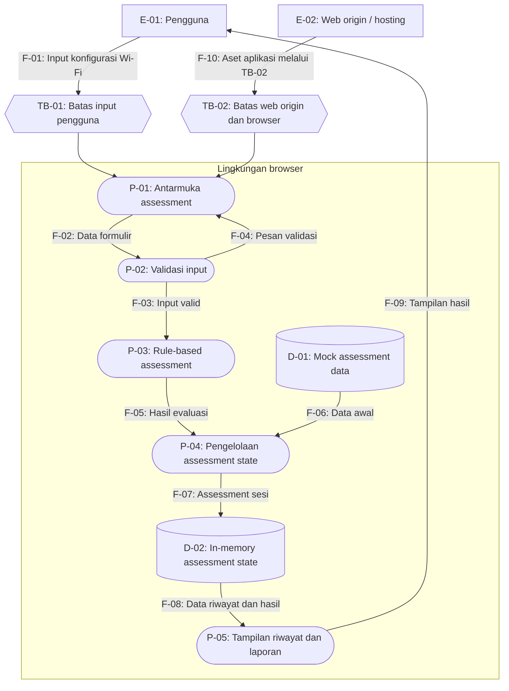

# Data Flow Diagram (DFD) — WiFi Check

## 1. Tujuan

Dokumen ini menggambarkan entitas, proses, penyimpanan data, aliran informasi, dan trust boundaries pada aplikasi WiFi Check.

DFD digunakan sebagai dasar untuk mengidentifikasi ancaman keamanan dengan metode STRIDE.

Diagram ini menggambarkan arsitektur yang didokumentasikan untuk milestone frontend. Diagram tidak mengasumsikan adanya backend, API assessment, atau database permanen yang belum terverifikasi.

## 2. Ruang Lingkup

DFD mencakup:

- Pengguna yang memasukkan konfigurasi Wi-Fi secara manual.
- Antarmuka web yang berjalan pada browser.
- Validasi input.
- Proses evaluasi berbasis aturan.
- Pengelolaan data assessment menggunakan React state.
- Mock data, riwayat, dan tampilan laporan.
- Pengiriman aset aplikasi dari web origin ke browser.

DFD tidak mencakup pemindaian Wi-Fi langsung, koneksi otomatis ke router, penangkapan paket jaringan, atau integrasi backend yang belum tersedia pada milestone ini.

## 3. Identifikasi Elemen DFD

### 3.1 Entitas eksternal

| ID | Nama | Deskripsi |
|---|---|---|
| E-01 | Pengguna | Mengisi konfigurasi Wi-Fi dan membaca hasil evaluasi |
| E-02 | Web origin / lingkungan hosting | Menyediakan aset aplikasi web kepada browser; detail deployment aktual perlu diverifikasi |

### 3.2 Proses

| ID | Nama proses | Deskripsi |
|---|---|---|
| P-01 | Antarmuka assessment | Menampilkan formulir dan menerima input pengguna |
| P-02 | Validasi input | Memeriksa kelengkapan dan format input sebelum evaluasi |
| P-03 | Rule-based assessment | Mengevaluasi konfigurasi dan menghasilkan risiko, temuan, serta rekomendasi |
| P-04 | Pengelolaan assessment state | Mengelola data awal dan hasil assessment menggunakan state aplikasi |
| P-05 | Tampilan riwayat dan laporan | Menampilkan daftar assessment dan detail hasil berdasarkan data yang tersedia |

### 3.3 Penyimpanan data

| ID | Nama penyimpanan | Deskripsi |
|---|---|---|
| D-01 | Mock assessment data | Data simulasi yang disediakan aplikasi |
| D-02 | In-memory assessment state | Data assessment yang dikelola selama sesi aplikasi menggunakan React state |

**Catatan:** D-02 bukan database permanen. Tidak ada database persisten yang diasumsikan dalam diagram ini.

### 3.4 Trust boundaries

| ID | Nama batas kepercayaan | Penjelasan |
|---|---|---|
| TB-01 | Batas pengguna dan aplikasi pada browser | Memisahkan input yang dikendalikan pengguna dari proses dan komponen aplikasi |
| TB-02 | Batas web origin dan browser | Memisahkan lingkungan yang menyajikan aset aplikasi dari lingkungan browser yang menerima dan menjalankan kode |

TB-01 penting karena input pengguna tidak boleh langsung dianggap tepercaya. TB-02 penting karena keamanan pengiriman kode bergantung pada origin, transport, dan konfigurasi deployment aktual.

Keberadaan trust boundary tidak otomatis berarti perlindungannya sudah memadai.

## 4. Diagram DFD

**Interpretasi diagram:** F-10 menggambarkan pengiriman aset aplikasi dari web origin ke browser. Aliran ini bukan permintaan API untuk memindai jaringan. Aliran F-01 sampai F-09 menggambarkan interaksi dan pengolahan data pada aplikasi frontend.

## 5. Daftar Aliran Data

| ID | Sumber | Tujuan | Data yang mengalir | Pertimbangan keamanan |
|---|---|---|---|---|
| F-01 | E-01 | P-01 melalui TB-01 | SSID, protokol, status perlindungan password, WPS, firmware, catatan | Input dapat dimanipulasi atau berisi data tidak valid |
| F-02 | P-01 | P-02 | Data formulir | Validasi harus diterapkan sebelum evaluasi |
| F-03 | P-02 | P-03 | Input yang lolos validasi | Aturan harus memproses data dengan benar |
| F-04 | P-02 | P-01 | Pesan kesalahan validasi | Pesan harus jelas dan tidak merusak tampilan |
| F-05 | P-03 | P-04 | Kategori risiko, temuan, rekomendasi | Hasil harus konsisten dengan input dan aturan |
| F-06 | D-01 | P-04 | Data assessment awal | Mock data tidak boleh dianggap sebagai hasil pemindaian nyata |
| F-07 | P-04 | D-02 | Data assessment selama sesi | Integritas state perlu dijaga; data tidak bersifat persisten |
| F-08 | D-02 | P-05 | Data riwayat dan hasil assessment | Data laporan harus sesuai dengan assessment yang dituju |
| F-09 | P-05 | E-01 | Informasi hasil dan rekomendasi | Informasi harus ditampilkan secara benar dan aman |
| F-10 | E-02 | P-01 melalui TB-02 | Aset aplikasi web | Kerahasiaan dan integritas pengiriman perlu mempertimbangkan TLS dan konfigurasi hosting |

## 6. Perlindungan Kriptografi pada Aliran Data

| Aliran/aset | Status perlindungan | Catatan |
|---|---|---|
| F-01 sampai F-09 | Belum ditemukan bukti enkripsi khusus di tingkat aplikasi pada pemeriksaan awal | Pengolahan berlangsung di frontend; jangan mengklaim enkripsi end-to-end |
| F-10 | Belum terverifikasi | HTTPS/TLS perlu diperiksa pada deployment aktual |
| D-01 | Tidak ada enkripsi khusus yang terverifikasi | Data simulasi disediakan aplikasi |
| D-02 | Tidak ada enkripsi khusus yang terverifikasi | Data berada dalam state aplikasi selama sesi |
| Fingerprint konfigurasi | Belum diimplementasikan berdasarkan dokumentasi milestone | SHA-256 tercantum sebagai rencana masa depan |

Klasifikasi ini membedakan kontrol yang diketahui dari kontrol yang masih perlu diperiksa. Jangan memberi label “terenkripsi” hanya karena aplikasi berjalan pada browser atau menggunakan framework modern.

## 7. Batasan dan Asumsi DFD

1. DFD menggambarkan arsitektur frontend sesuai dokumentasi milestone yang diperiksa.
2. Validasi dan rule-based assessment diasumsikan berjalan di sisi klien.
3. Tidak ada aliran data ke database permanen yang ditampilkan karena belum menjadi bagian implementasi saat ini.
4. Tidak ada layanan autentikasi, otorisasi, API, atau koneksi router yang ditambahkan tanpa bukti implementasi.
5. Detail lingkungan hosting dan penggunaan HTTPS perlu dikonfirmasi.
6. Jika backend atau database ditambahkan pada milestone berikutnya, DFD harus diperbarui.

## 8. Hubungan dengan STRIDE

Elemen DFD berikut menjadi titik awal identifikasi ancaman:

- **E-01:** manipulasi input dan penyalahgunaan interaksi pengguna.
- **E-02 dan F-10:** ancaman pada penyediaan serta pengiriman aset aplikasi.
- **P-01 dan P-02:** input tidak valid, manipulasi tampilan, dan validasi yang tidak memadai.
- **P-03:** perubahan atau kesalahan aturan penilaian.
- **P-04, D-01, dan D-02:** perubahan data, state yang tidak konsisten, serta kehilangan data sesi.
- **P-05 dan F-09:** manipulasi hasil atau penyajian laporan yang tidak sesuai.
- **TB-01 dan TB-02:** titik yang memerlukan perhatian khusus ketika menilai kepercayaan terhadap input dan komunikasi.

Ancaman aktual, kemungkinan eksploitasi, dampak, dan mitigasi akan dianalisis secara terpisah pada `threat-model.md` dan `risk-register.md`.

## 9. Referensi

Repository: https://github.com/AhmadHaikalHarahap/105224002-WifiCheck

File yang menjadi acuan:

- `README.md`
- `components/assessment/AssessmentForm.tsx`
- `components/providers/AssessmentProvider.tsx`
- `lib/assessment-rules.ts`
- `lib/validation.ts`
- `data/mock-assessments.ts`
- `app/history/page.tsx`
- `app/reports/[id]/`

Dokumen ini harus ditinjau ulang jika hasil pemeriksaan source code atau implementasi deployment menunjukkan arsitektur yang berbeda.